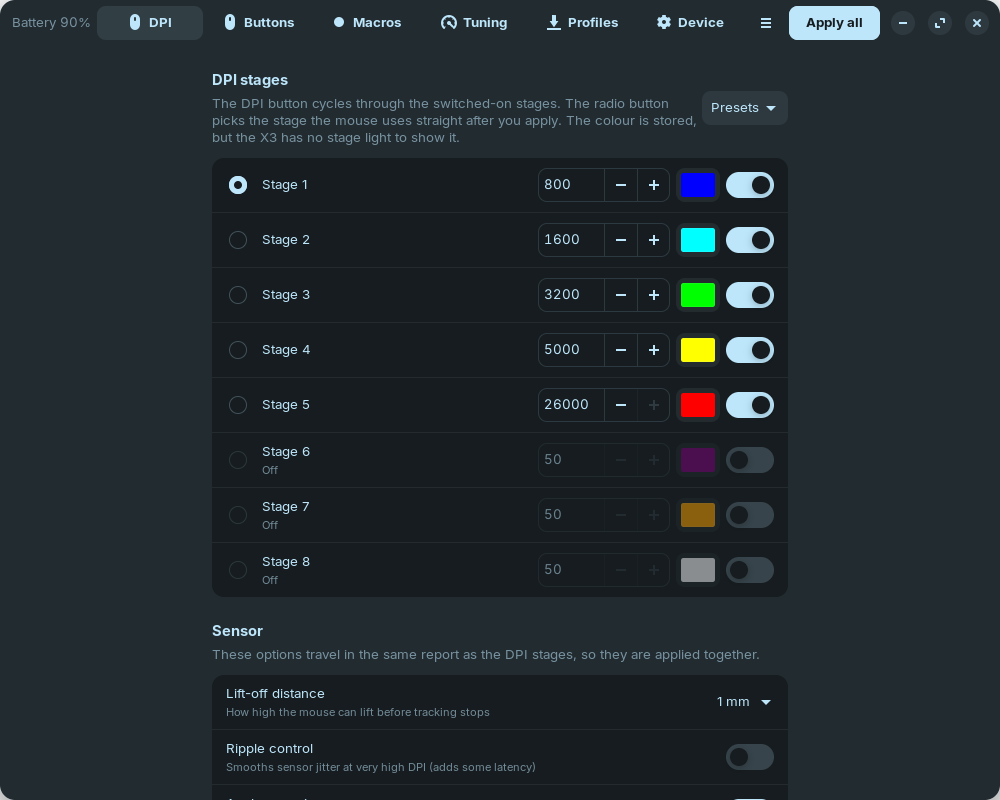
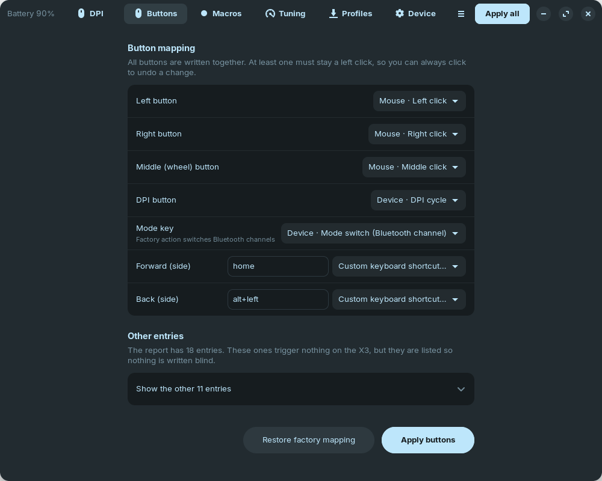
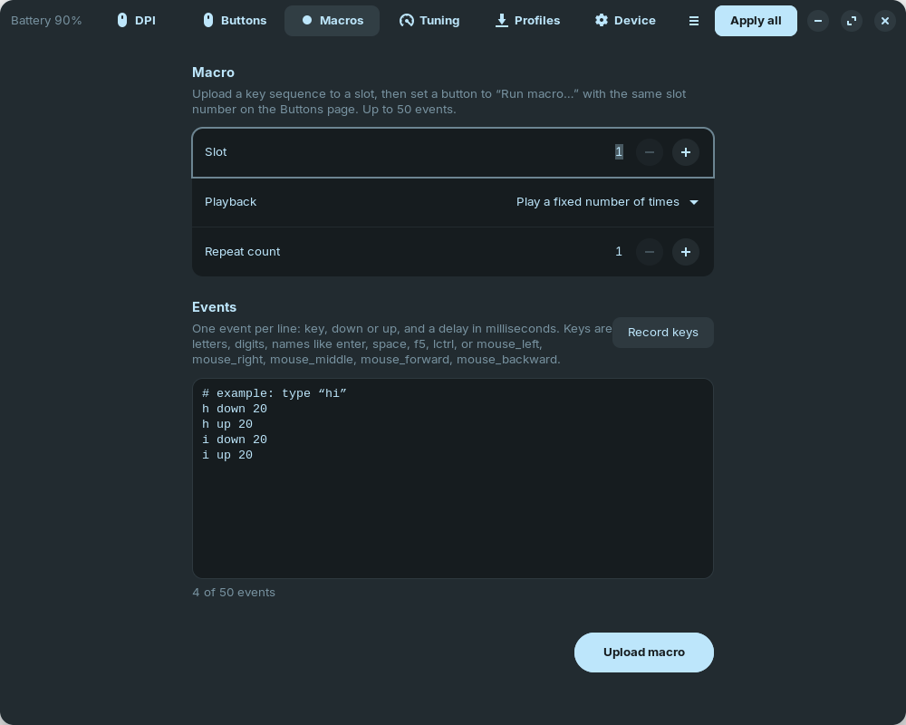
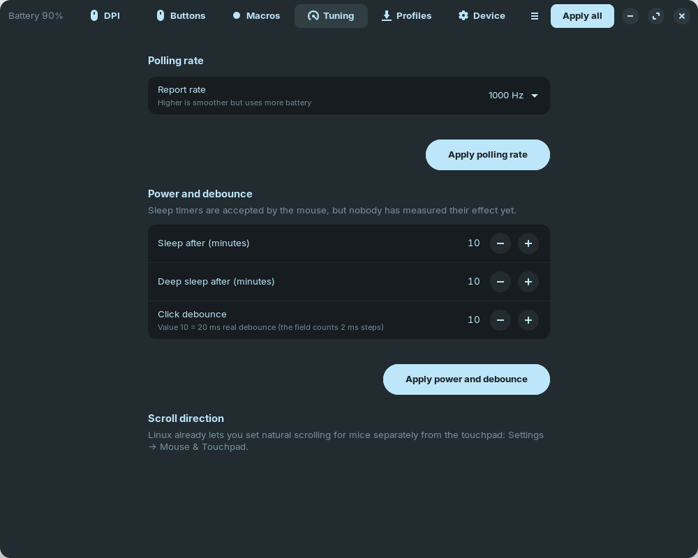
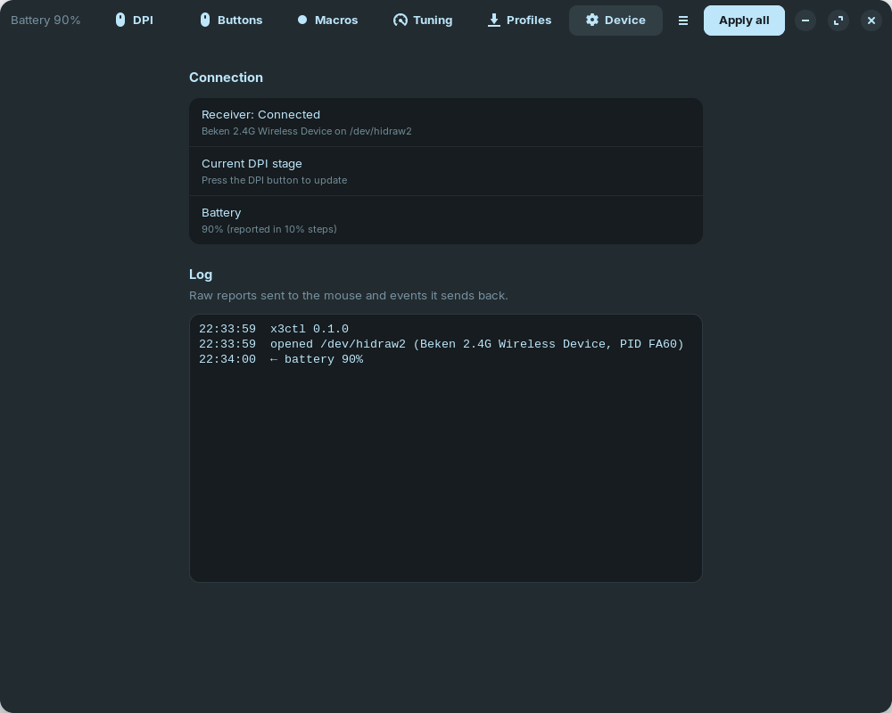

# x3ctl — Attack Shark X3 configurator for Linux

A GTK 4 / libadwaita app for setting up the Attack Shark X3 mouse on Linux: DPI stages,
polling rate, button mapping, macros, sensor options and power settings. It works over the
mouse's 2.4 GHz receiver. The vendor only ships configuration software for Windows.

This is a Linux port of [asctl](https://github.com/yourchocomate/attacksharkx3), the macOS
tool by Habibur Rahman. See [Credits](#credits).



## Requirements

- Python 3.10 or newer
- PyGObject with GTK 4 and libadwaita 1.5 or newer

Zorin OS 18 and Ubuntu 24.04 or newer already include all of these. On other Debian-based
systems:

```bash
sudo apt install python3-gi gir1.2-gtk-4.0 gir1.2-adw-1
```

On Fedora: `sudo dnf install python3-gobject gtk4 libadwaita`. On Arch:
`sudo pacman -S python-gobject gtk4 libadwaita`.

## Install

```bash
git clone <this repository>
cd <repository folder>
./install.sh
```

`install.sh` does two things:

1. Installs a udev rule in `/etc/udev/rules.d` (asks for your password once). The rule
   lets the logged-in user talk to the receiver without root.
2. Adds **Attack Shark X3** to your app menu.

If the app still reports no permission, unplug the receiver and plug it back in.

To run it without installing the menu entry: `./x3ctl.sh`

## What it can set

| Page | Settings |
|---|---|
| DPI | 8 stages (50–26000 in steps of 50), each on or off, the starting stage, lift-off distance, ripple control, angle snapping, motion sync |
| Buttons | An action for each of the 7 physical buttons: clicks, DPI, media keys, Linux shortcuts, custom key combinations, macros |
| Macros | Up to 50 key or mouse events per slot, typed in or recorded from the keyboard, with three repeat modes |
| Tuning | Polling rate 125–1000 Hz, sleep timers, click debounce |
| Profiles | Named sets of settings saved on this computer |
| Device | Connection status, live battery level and DPI stage, and a log of every report sent |

### Screenshots

| Buttons | Macros |
|---|---|
|  |  |
| **Tuning** | **Device** |
|  |  |

### Tested on hardware

| Feature | Status on Linux |
|---|---|
| DPI stages | Works; the pointer speed changes |
| DPI stage events | Work; stages are numbered from 1 |
| Battery level over the receiver | Works; reported every few seconds in 10% steps |
| Button mapping (media keys, shortcuts) | Works |
| Macros | Work; a button set to macro N plays macro slot N |
| Polling rate, sleep timers, debounce | The mouse acknowledges them; their effect hasn't been measured on Linux |
| Bluetooth configuration | Not ported yet |

## Things to know

- **The mouse can't report its settings.** The protocol only allows writing, so the app
  shows what it last sent, stored in `~/.config/x3ctl/`. Until you apply once, the editor
  shows the mouse's stock values.
- Each page has its own Apply button; **Apply all** sends everything.
- The button mapping must always include at least one left click, so you can't lock
  yourself out. **Restore factory mapping** puts the original layout back.
- Built-in shortcuts follow Linux conventions (Ctrl+C, Alt+Tab, Super+L and so on).
  Navigating back in Files and in web browsers is **Alt+Left**. On GNOME, Ctrl+Alt+Left
  switches workspace instead.
- The X3 has no light you can control. The per-stage colours are stored in the
  settings but nothing on the mouse shows them.
- Natural scrolling is already a per-device setting in GNOME (Settings → Mouse &
  Touchpad), so this app doesn't handle scroll direction.

## How it works

Settings are HID feature reports, sent through `/dev/hidraw` with Python's standard
library alone: no extra libraries and no kernel driver. Each report must come straight
after a short preamble report, or the mouse acknowledges it and then ignores it. The
mouse sends input report `0x03` for status events: write acknowledgements, DPI stage
changes and battery level. The full protocol notes are in
[asctl's README](https://github.com/yourchocomate/attacksharkx3#protocol-notes).

| Path | Contents |
|---|---|
| `x3ctl/protocol.py` | Report builders, ported from asctl |
| `x3ctl/device.py` | hidraw discovery, feature-report writes, status reader |
| `x3ctl/gui.py` | The GTK 4 / libadwaita window |
| `x3ctl/keys.py` | Key names, HID usages, evdev keycodes for macro recording |
| `x3ctl/store.py` | Last applied settings, profiles, macros |
| `packaging/` | udev rule and desktop entry |

## Tests

```bash
python3 -m unittest tests/test_protocol.py
```

The tests check the generated reports against the test vectors from asctl's own
self-test. They don't need the mouse.

## Uninstall

```bash
./uninstall.sh
```

This removes the udev rule and the menu entry. Your saved settings stay in
`~/.config/x3ctl/`.

## Credits

**Many thanks to [Habibur Rahman](https://github.com/yourchocomate)**, author of
[asctl](https://github.com/yourchocomate/attacksharkx3). He reverse-engineered the X3's
configuration protocol from the vendor's Windows software and verified each feature by
measuring it on the mouse. His work includes the report layouts, the mandatory preamble,
the DPI encoding, the button action table and the macro format. This Linux port
reimplements his published source in Python and would not have been possible without it.
If this tool is useful to you, please star his project too.

## License

MIT, see [LICENSE](LICENSE). The protocol code is derived from asctl and keeps its
original MIT copyright notice.

Not affiliated with or endorsed by Attack Shark. Use at your own risk.
